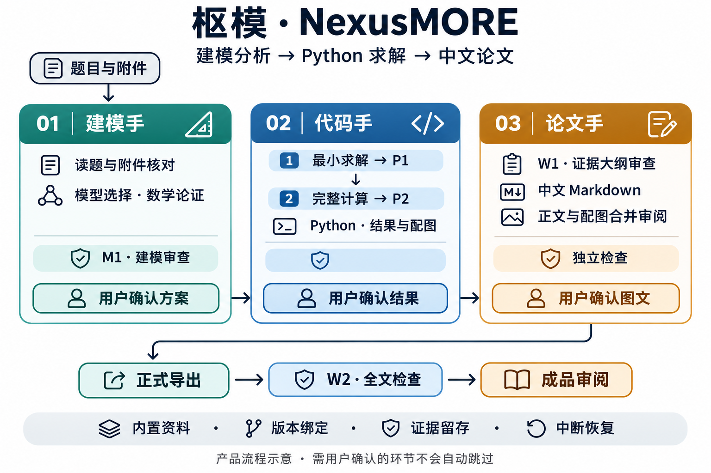
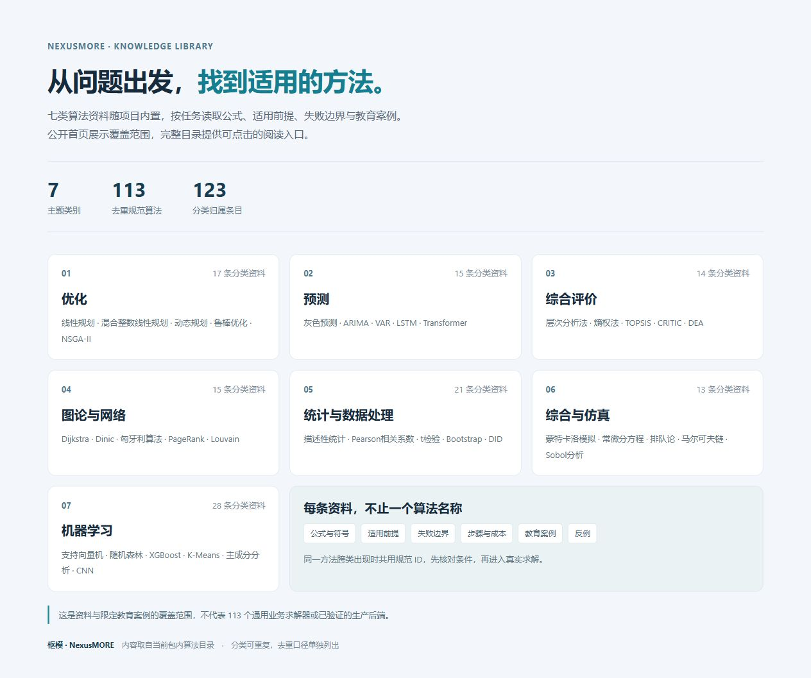

<div align="center">

# 枢模 · NexusMORE

**从建模方案到中文论文，让计算、审阅与证据连成一条工作流。**


[](LICENSE)

[快速开始](#-快速开始) · [算法资料库](#-算法资料库) · [使用指南](docs/user-guide.md) · [支持范围](docs/compatibility.md) · [参与贡献](docs/contributing.md)

</div>

---

## 📖 简介

枢模 · NexusMORE 是面向中文数学建模研究的本地 Agent 工作流。它把任务组织为 **建模分析 → Python 求解 → 中文论文** 三个阶段，让方案、代码、结果、图片和正文保持可追溯的版本关系。

你可以在 DSH 原生会话中提交题目、讨论方案、查看文件并提出修改；系统负责资料路由、受控执行、独立质检和中断恢复。在需要作出研究判断的位置，由你审阅并确认当前版本。

> 当前为开发预览版。本地 Windows / DSH 流程已有实测，新设备安装仍待验证；具体模型、工具和导出限制见[支持范围](docs/compatibility.md)。

## ✨ 核心能力

| 能力 | 可以做什么 |
|---|---|
| 🧠 建模分析 | 核对题面与附件，讨论假设、模型、算法和检验口径，按需读取内置资料 |
| 💻 Python 求解 | 先验证最小求解，再执行完整计算；在受控 Docker 容器中运行生成的代码 |
| 📊 结果与配图 | 展示带单位的表格、检验及候选图，保留原始数据、误差和文件身份 |
| 📝 中文论文 | 基于已确认的结果撰写 Markdown；全篇统一符号表，支持中文图表与数学表达 |
| 🛡️ 独立质检 | 在 M1、P1、P2、W1、W2 节点使用独立上下文审查，记录失败与修订 |
| 🤝 原生审阅 | 在 DSH 打开审阅文件并回复；同版本正文与配图可一次合并确认 |
| 🔁 可恢复运行 | 持久化状态、请求及回执；中断后查询原任务，避免重复执行 |
| 📦 内置资料 | 随包携带算法、数学论证、中文论文规范及文档工具入口，无需另装技能包 |

## 🔄 三手工作流



| 阶段 | 主要工作 | 交付内容 |
|---|---|---|
| 建模手 | 问题分析、资料选择、数学论证和模型设计 | 当前版本的可读方案与检验要求 |
| 代码手 | 最小求解、完整计算、结果检验与绘图 | Python 代码、数值结果、候选图和复跑证据 |
| 论文手 | 组织论证、撰写中文正文、汇编和导出 | Markdown 审阅稿、合并图文审阅页及正式文档 |

独立质检是阶段内的只读审查，不是第四个常驻业务角色。出现错误时按影响返回相应阶段修订；用户确认、独立检查与程序执行各自记录。详见[架构说明](docs/architecture.md)。

## 🚀 快速开始

### 环境准备

当前面向 **Windows x86_64 + CPython 3.13 + Docker Desktop/WSL2 Linux 容器**，宿主使用 **DSH Desktop 0.2.2-rc.1**。DSH 自带 Python 3.12 不能作为枢模后端。模型服务的端点、模型名和密钥由你配置，图像质检需相应模型能力。

### 1. 获取与安装

在 PowerShell 中执行：

```powershell
git clone https://github.com/kawayua/NexusMORE.git
cd NexusMORE
py -3.13 -m venv .venv
$python = (Resolve-Path .\.venv\Scripts\python.exe).Path
& $python -m pip install ".[paper,dsh]"
$env:MODELCREW_WORKSPACE = Join-Path $env:LOCALAPPDATA "NexusMORE\workspace"
& $python -m modelcrew init
& $python -m modelcrew resources-check
```

`nexusmore` 是发行名，`modelcrew` 是命令和 Python 包名。没有 `py` 启动器时，可使用实际 CPython 3.13 的完整路径。当前从源码安装，未提供通用的一键安装或预编译发行包承诺。

### 2. 配置模型与服务

在工作区 `configs/local/settings.json` 填写 `model.provider`、`model.base_url` 和 `model.name`；密钥保存到同目录的 `secrets.env`，对应 `model.api_key_env` 指定的变量名。

```powershell
& $python -m modelcrew environment setup
& $python -m modelcrew.workflow_mcp migrate
& $python -m modelcrew doctor --profile workflow --services
```

先启动 Docker。准备命令可能下载依赖、镜像和文档工具，不会安装 Docker、DSH 或 Microsoft Word，也不调用模型。配置字段及首次联网需求见[用户配置](docs/user-configuration.md)和[环境准备](docs/environment-preparation.md)。

### 3. 接入 DSH

```powershell
& $python -m modelcrew.dsh_integration render --python $python --workspace $env:MODELCREW_WORKSPACE
& $python -m modelcrew.dsh_integration install --python $python --workspace $env:MODELCREW_WORKSPACE --profile "$env:USERPROFILE\.dsh\profiles\desktop"
```

`--profile` 使用自己实际的 DSH profile。完整退出并重开 DSH，在输入框执行 `/nexusmore` 检查连接，然后附上题面和数据开始讨论。接入与回退见[DSH 使用说明](docs/dsh-local-connection.md)。

## 💬 使用示例

从题目开始：

```text
请用枢模分析附件中的问题一。先核对输入和输出要求，提出建模方案与检验方法，等我确认方案后再进入求解。
```

继续已有研究：

```text
请基于当前已确认的模型继续 Python 求解，先验证最小案例，再计算完整结果。结果中单独说明单位、误差和验证结论。
```

结果进入写作：

```text
请根据当前已经确认的结果撰写中文论文审阅稿，并把正文与全部候选图放在同一审阅页，标明暂列入文图与备选图。
```

打开系统附上的当前审阅文件，阅读后明确回复“通过”，或直接提出修改意见。正文与配图的合并确认绑定当前版本；结果确认、图文确认和最终成品审阅的范围各自独立。具体步骤见[使用指南](docs/user-guide.md)。

## 🧮 算法资料库



**7 类主题 · 113 种去重规范算法 · 123 条分类归属**

按题目结构查找方法，先核对适用条件与失败边界，再读取公式、步骤和教育案例。跨类方法共用规范 ID，分类条目合计 123，去重后为 113。

| 类别与阅读入口 | 分类条目 | 部分代表方法 |
|---|---:|---|
| [优化](src/modelcrew/resources/algorithms/knowledge/optimization.md) | 17 | 线性规划、混合整数线性规划、动态规划、鲁棒优化、NSGA-II |
| [预测](src/modelcrew/resources/algorithms/knowledge/prediction.md) | 15 | 灰色预测、ARIMA、VAR、LSTM、Transformer |
| [综合评价](src/modelcrew/resources/algorithms/knowledge/evaluation.md) | 14 | 层次分析法、熵权法、TOPSIS、CRITIC、DEA |
| [图论与网络](src/modelcrew/resources/algorithms/knowledge/graph.md) | 15 | Dijkstra、Dinic、匈牙利算法、PageRank、Louvain |
| [统计与数据处理](src/modelcrew/resources/algorithms/knowledge/statistics.md) | 21 | 描述性统计、Pearson相关系数、t检验、Bootstrap、DID |
| [综合与仿真](src/modelcrew/resources/algorithms/knowledge/simulation.md) | 13 | 蒙特卡洛模拟、常微分方程、排队论、马尔可夫链、Sobol分析 |
| [机器学习](src/modelcrew/resources/algorithms/knowledge/machine-learning.md) | 28 | 支持向量机、随机森林、XGBoost、K-Means、主成分分析、CNN |

每条资料包含**公式与符号、适用前提、失败边界、步骤与成本、固定教育案例及反例**。这是资料与限定案例的覆盖范围；真实任务的求解后端、依赖和结论仍需另行检验。

<details>
<summary>展开七类完整算法目录</summary>

### 优化 · 17 条

[线性规划](src/modelcrew/resources/algorithms/knowledge/optimization.md#lp) · [整数规划](src/modelcrew/resources/algorithms/knowledge/optimization.md#ip) · [混合整数线性规划](src/modelcrew/resources/algorithms/knowledge/optimization.md#milp) · [非线性规划](src/modelcrew/resources/algorithms/knowledge/optimization.md#nlp) · [0-1规划](src/modelcrew/resources/algorithms/knowledge/optimization.md#binary-ip) · [动态规划](src/modelcrew/resources/algorithms/knowledge/optimization.md#dynamic-programming) · [多目标规划](src/modelcrew/resources/algorithms/knowledge/optimization.md#multi-objective) · [二次规划](src/modelcrew/resources/algorithms/knowledge/optimization.md#qp) · [目标规划](src/modelcrew/resources/algorithms/knowledge/optimization.md#goal-programming) · [鲁棒优化](src/modelcrew/resources/algorithms/knowledge/optimization.md#robust-optimization) · [遗传算法](src/modelcrew/resources/algorithms/knowledge/optimization.md#ga) · [粒子群算法](src/modelcrew/resources/algorithms/knowledge/optimization.md#pso) · [模拟退火](src/modelcrew/resources/algorithms/knowledge/optimization.md#sa) · [蚁群算法](src/modelcrew/resources/algorithms/knowledge/optimization.md#aco) · [差分进化](src/modelcrew/resources/algorithms/knowledge/optimization.md#de) · [禁忌搜索](src/modelcrew/resources/algorithms/knowledge/optimization.md#tabu) · [NSGA-II](src/modelcrew/resources/algorithms/knowledge/optimization.md#nsga2)

### 预测 · 15 条

[线性回归](src/modelcrew/resources/algorithms/knowledge/prediction.md#linear-regression) · [多项式回归](src/modelcrew/resources/algorithms/knowledge/prediction.md#polynomial-regression) · [指数平滑](src/modelcrew/resources/algorithms/knowledge/prediction.md#exponential-smoothing) · [灰色预测](src/modelcrew/resources/algorithms/knowledge/prediction.md#gm11) · [ARIMA](src/modelcrew/resources/algorithms/knowledge/prediction.md#arima) · [SARIMA](src/modelcrew/resources/algorithms/knowledge/prediction.md#sarima) · [VAR](src/modelcrew/resources/algorithms/knowledge/prediction.md#var) · [Prophet](src/modelcrew/resources/algorithms/knowledge/prediction.md#prophet) · [XGBoost](src/modelcrew/resources/algorithms/knowledge/prediction.md#xgboost) · [LightGBM](src/modelcrew/resources/algorithms/knowledge/prediction.md#lightgbm) · [CatBoost](src/modelcrew/resources/algorithms/knowledge/prediction.md#catboost) · [LSTM](src/modelcrew/resources/algorithms/knowledge/prediction.md#lstm) · [GRU](src/modelcrew/resources/algorithms/knowledge/prediction.md#gru) · [TCN](src/modelcrew/resources/algorithms/knowledge/prediction.md#tcn) · [Transformer](src/modelcrew/resources/algorithms/knowledge/prediction.md#transformer)

### 综合评价 · 14 条

[层次分析法](src/modelcrew/resources/algorithms/knowledge/evaluation.md#ahp) · [熵权法](src/modelcrew/resources/algorithms/knowledge/evaluation.md#entropy-weight) · [TOPSIS](src/modelcrew/resources/algorithms/knowledge/evaluation.md#topsis) · [加权评分法](src/modelcrew/resources/algorithms/knowledge/evaluation.md#weighted-score) · [CRITIC](src/modelcrew/resources/algorithms/knowledge/evaluation.md#critic) · [主成分分析](src/modelcrew/resources/algorithms/knowledge/evaluation.md#pca) · [因子分析](src/modelcrew/resources/algorithms/knowledge/evaluation.md#factor-analysis) · [灰色关联分析](src/modelcrew/resources/algorithms/knowledge/evaluation.md#grey-relation) · [模糊综合评价](src/modelcrew/resources/algorithms/knowledge/evaluation.md#fuzzy-evaluation) · [VIKOR](src/modelcrew/resources/algorithms/knowledge/evaluation.md#vikor) · [PROMETHEE](src/modelcrew/resources/algorithms/knowledge/evaluation.md#promethee) · [ELECTRE](src/modelcrew/resources/algorithms/knowledge/evaluation.md#electre) · [DEA](src/modelcrew/resources/algorithms/knowledge/evaluation.md#dea) · [Malmquist指数](src/modelcrew/resources/algorithms/knowledge/evaluation.md#malmquist)

### 图论与网络 · 15 条

[深度优先搜索](src/modelcrew/resources/algorithms/knowledge/graph.md#dfs) · [广度优先搜索](src/modelcrew/resources/algorithms/knowledge/graph.md#bfs) · [Dijkstra](src/modelcrew/resources/algorithms/knowledge/graph.md#dijkstra) · [Floyd](src/modelcrew/resources/algorithms/knowledge/graph.md#floyd) · [Bellman-Ford](src/modelcrew/resources/algorithms/knowledge/graph.md#bellman-ford) · [Prim](src/modelcrew/resources/algorithms/knowledge/graph.md#prim) · [Kruskal](src/modelcrew/resources/algorithms/knowledge/graph.md#kruskal) · [Dinic](src/modelcrew/resources/algorithms/knowledge/graph.md#dinic) · [最小费用最大流](src/modelcrew/resources/algorithms/knowledge/graph.md#min-cost-flow) · [匈牙利算法](src/modelcrew/resources/algorithms/knowledge/graph.md#hungarian) · [PageRank](src/modelcrew/resources/algorithms/knowledge/graph.md#pagerank) · [Louvain](src/modelcrew/resources/algorithms/knowledge/graph.md#louvain) · [K最短路径](src/modelcrew/resources/algorithms/knowledge/graph.md#k-shortest) · [图着色](src/modelcrew/resources/algorithms/knowledge/graph.md#graph-coloring) · [中心性分析](src/modelcrew/resources/algorithms/knowledge/graph.md#centrality)

### 统计与数据处理 · 21 条

[描述性统计](src/modelcrew/resources/algorithms/knowledge/statistics.md#descriptive) · [Min-Max标准化](src/modelcrew/resources/algorithms/knowledge/statistics.md#minmax) · [Z-score标准化](src/modelcrew/resources/algorithms/knowledge/statistics.md#zscore) · [均值/中位数填补](src/modelcrew/resources/algorithms/knowledge/statistics.md#imputation) · [KNN填补](src/modelcrew/resources/algorithms/knowledge/statistics.md#knn-imputation) · [3σ原则](src/modelcrew/resources/algorithms/knowledge/statistics.md#three-sigma) · [IQR](src/modelcrew/resources/algorithms/knowledge/statistics.md#iqr) · [LOF](src/modelcrew/resources/algorithms/knowledge/statistics.md#lof) · [Pearson相关系数](src/modelcrew/resources/algorithms/knowledge/statistics.md#pearson) · [Spearman相关系数](src/modelcrew/resources/algorithms/knowledge/statistics.md#spearman) · [Kendall相关系数](src/modelcrew/resources/algorithms/knowledge/statistics.md#kendall) · [t检验](src/modelcrew/resources/algorithms/knowledge/statistics.md#ttest) · [卡方检验](src/modelcrew/resources/algorithms/knowledge/statistics.md#chi-square) · [方差分析](src/modelcrew/resources/algorithms/knowledge/statistics.md#anova) · [Bootstrap](src/modelcrew/resources/algorithms/knowledge/statistics.md#bootstrap) · [线性回归](src/modelcrew/resources/algorithms/knowledge/statistics.md#linear-regression) · [Logistic回归](src/modelcrew/resources/algorithms/knowledge/statistics.md#logistic-regression) · [VIF](src/modelcrew/resources/algorithms/knowledge/statistics.md#vif) · [ADF检验](src/modelcrew/resources/algorithms/knowledge/statistics.md#adf) · [DID](src/modelcrew/resources/algorithms/knowledge/statistics.md#did) · [倾向得分匹配](src/modelcrew/resources/algorithms/knowledge/statistics.md#psm)

### 综合与仿真 · 13 条

[蒙特卡洛模拟](src/modelcrew/resources/algorithms/knowledge/simulation.md#monte-carlo) · [差分方程](src/modelcrew/resources/algorithms/knowledge/simulation.md#difference-equation) · [常微分方程](src/modelcrew/resources/algorithms/knowledge/simulation.md#ode) · [排队论](src/modelcrew/resources/algorithms/knowledge/simulation.md#queueing) · [马尔可夫链](src/modelcrew/resources/algorithms/knowledge/simulation.md#markov) · [元胞自动机](src/modelcrew/resources/algorithms/knowledge/simulation.md#cellular-automata) · [系统动力学](src/modelcrew/resources/algorithms/knowledge/simulation.md#system-dynamics) · [离散事件仿真](src/modelcrew/resources/algorithms/knowledge/simulation.md#discrete-event) · [随机过程](src/modelcrew/resources/algorithms/knowledge/simulation.md#stochastic-process) · [贝叶斯网络](src/modelcrew/resources/algorithms/knowledge/simulation.md#bayesian-network) · [Agent-Based Modeling](src/modelcrew/resources/algorithms/knowledge/simulation.md#abm) · [敏感性分析](src/modelcrew/resources/algorithms/knowledge/simulation.md#sensitivity) · [Sobol分析](src/modelcrew/resources/algorithms/knowledge/simulation.md#sobol)

### 机器学习 · 28 条

[线性回归](src/modelcrew/resources/algorithms/knowledge/machine-learning.md#linear-regression) · [Logistic回归](src/modelcrew/resources/algorithms/knowledge/machine-learning.md#logistic-regression) · [决策树](src/modelcrew/resources/algorithms/knowledge/machine-learning.md#decision-tree) · [支持向量机](src/modelcrew/resources/algorithms/knowledge/machine-learning.md#svm) · [K近邻](src/modelcrew/resources/algorithms/knowledge/machine-learning.md#knn) · [随机森林](src/modelcrew/resources/algorithms/knowledge/machine-learning.md#random-forest) · [朴素贝叶斯](src/modelcrew/resources/algorithms/knowledge/machine-learning.md#naive-bayes) · [AdaBoost](src/modelcrew/resources/algorithms/knowledge/machine-learning.md#adaboost) · [GBDT](src/modelcrew/resources/algorithms/knowledge/machine-learning.md#gbdt) · [XGBoost](src/modelcrew/resources/algorithms/knowledge/machine-learning.md#xgboost) · [LightGBM](src/modelcrew/resources/algorithms/knowledge/machine-learning.md#lightgbm) · [CatBoost](src/modelcrew/resources/algorithms/knowledge/machine-learning.md#catboost) · [Stacking](src/modelcrew/resources/algorithms/knowledge/machine-learning.md#stacking) · [K-Means](src/modelcrew/resources/algorithms/knowledge/machine-learning.md#kmeans) · [层次聚类](src/modelcrew/resources/algorithms/knowledge/machine-learning.md#hierarchical) · [DBSCAN](src/modelcrew/resources/algorithms/knowledge/machine-learning.md#dbscan) · [GMM](src/modelcrew/resources/algorithms/knowledge/machine-learning.md#gmm) · [Mean Shift](src/modelcrew/resources/algorithms/knowledge/machine-learning.md#mean-shift) · [主成分分析](src/modelcrew/resources/algorithms/knowledge/machine-learning.md#pca) · [t-SNE](src/modelcrew/resources/algorithms/knowledge/machine-learning.md#tsne) · [UMAP](src/modelcrew/resources/algorithms/knowledge/machine-learning.md#umap) · [MLP](src/modelcrew/resources/algorithms/knowledge/machine-learning.md#mlp) · [CNN](src/modelcrew/resources/algorithms/knowledge/machine-learning.md#cnn) · [RNN](src/modelcrew/resources/algorithms/knowledge/machine-learning.md#rnn) · [LSTM](src/modelcrew/resources/algorithms/knowledge/machine-learning.md#lstm) · [GRU](src/modelcrew/resources/algorithms/knowledge/machine-learning.md#gru) · [Transformer](src/modelcrew/resources/algorithms/knowledge/machine-learning.md#transformer) · [Autoencoder](src/modelcrew/resources/algorithms/knowledge/machine-learning.md#autoencoder)

</details>

### 实际读取方式

```powershell
python -m modelcrew.algorithm_knowledge list --category optimization
python -m modelcrew.algorithm_knowledge read --id lp
python -m modelcrew.algorithm_knowledge check-examples --id lp
```

只读入口从安装包定位资料；教育案例复算需要相应 NumPy/SciPy 依赖。完整[知识索引](src/modelcrew/resources/algorithms/index.md)与[规范目录](src/modelcrew/resources/algorithms/knowledge/catalog.json)一并保留，逐任务按需读取。

## 🧰 内置资料与工具

| 类别 | 内容 |
|---|---|
| 算法资料 | 优化、预测、评价、图论、统计、综合与机器学习七类索引及几何补充 |
| 数学论证 | 公式、命题条件、证明与统计设计资料，用于模型论证和核对 |
| 中文论文 | 章节组织、统一符号说明、图表引用和 Markdown 审阅规范 |
| 文档工具 | PDF 读取、Word 结构检查、表格读取及受控文档工作区 |
| 配图与导出 | Python 绘图、PNG/PDF/SVG、全页检查及批准内容的同源导出 |

默认算法查询从包内按名称、ID 或类别读取。论文语义检索需要另行准备嵌入模型与 Qdrant 索引；候选文献或 DOI 匹配不等于真实性核验。

## 📁 仓库结构

```text
NexusMORE/
├── README.md
├── AGENTS.md
├── LICENSE
├── THIRD_PARTY_NOTICES.md
├── pyproject.toml
├── src/
│   ├── modelcrew/       # Python 业务核心与随包资源
│   └── harness/         # DSH 宿主适配器
├── configs/             # 依赖、服务与执行器配置
├── docs/                # 使用、配置、架构和贡献说明
├── examples/            # 原创小样例
├── scripts/             # 公开维护与检查入口
└── tests/               # 不依赖私有业务资料的测试
```

业务输入、运行证据和论文产物保存在独立用户工作区。公开仓库仅维护产品代码、用户文档及可共享测试；开发过程档案不作为安装前置材料。

## ✅ 支持范围

- 数据、求解、绘图和导出统一使用 **Python**。
- LaTeX 支持基线为 **Tectonic 0.17.0 / Pandoc 3.6.4**；Word 原生渲染需要已授权的 Microsoft Word 及相应字体。
- 其他宿主、Linux/macOS 主机及新设备安装尚无兼容性通过结论。
- 暂不支持其他 LaTeX 引擎、外置 BibTeX/Biber、任意 TeX→Word、表格公式重算或任意公式编辑。
- 科学正确性仍需独立检查与人的判断；模型执行成功或保留小数位数不等于数值准确。

完整边界见[兼容说明](docs/compatibility.md)，常见故障见[排错指南](docs/troubleshooting.md)。

## 🤝 参与贡献

欢迎提交可复现的问题、文档修订和合成测试。公开检查不需要模型密钥、Docker、Word 或私有题目：

```powershell
python -m pip install -e ".[dev,workflow,dsh]"
python -m scripts.check_public_repository
python -m pytest -q
```

请先阅读[贡献指南](docs/contributing.md)。不要在 issue、提交或附件中包含密钥、连接串、私人题面和运行原件。产品变化见[更新记录](docs/changelog.md)。

## 📄 许可

当前组合源码采用 [AGPL-3.0-only](LICENSE)，既有 Apache-2.0 授权及第三方许可按[第三方声明](THIRD_PARTY_NOTICES.md)保留。源码公开不表示所有预编译依赖、原生组件及对应源码材料已完成发行核对；当前不发布预编译安装包。详见[许可与发行说明](docs/combined-distribution-license.md)。

软件按许可证提供且不作担保。
